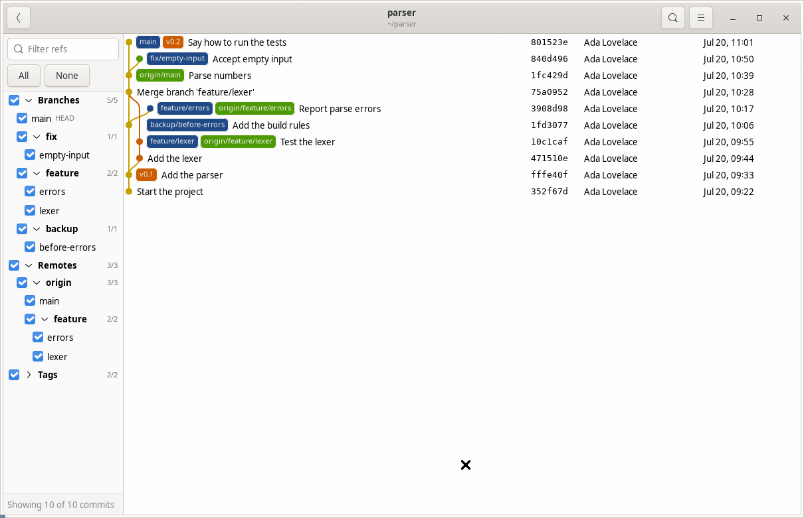
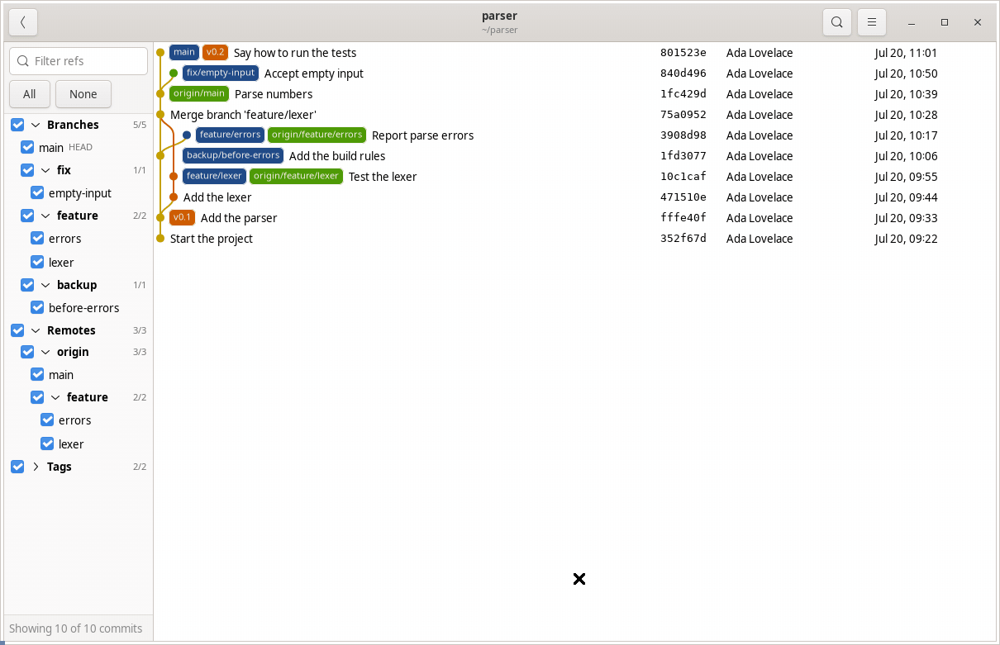
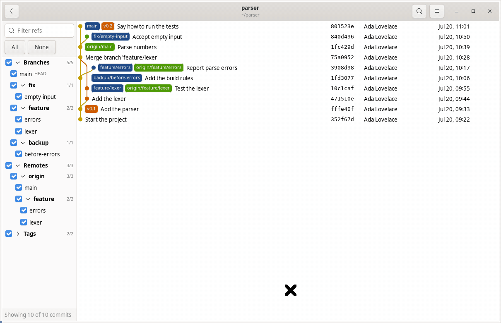

<p align="center">
  
</p>

# `gitrl-f`

> Search the git history, in only the refs that you tick

Somewhere in the history is the commit you want: the one that added a function, the one that changed a line, the one whose hash a colleague pasted in a chat. `git log` can find it with `-S`, `-G`, `-L` and a path, but it gives you a wall of text, and it gives you every branch, including the ones you do not care about. `gitrl-f` draws the history the way `gitg` does, with only the branches, remote branches and tags that you tick, and puts a search on top of it.

One search bar looks in three places: the messages, authors and hashes of the commits, the lines that each commit added or removed, and the files that each commit changed. The matches are in bold, and **Display matches only** hides the rest, with the graph joined across the gaps. Double click a commit and its details and its diff open below the history. There, Ctrl+F finds a word in every file of the diff, and a right click on lines shows only the commits that changed them. **It writes nothing to the repository.**

> [!TIP]
> gitrl-f is pronounced git-ROL-EFF (/ɡɪtˈrəʊlɛf/), after ctrl-f said aloud: control eff.



## Only the refs that you tick

Most days you care about two or three branches, not all of them. The panel on the left lists every branch, remote branch and tag, in groups split at the slashes of their names, so `feature/lexer` sits under `feature`. Tick the ones you want and the history redraws with only those. A commit shows when a ticked ref reaches it, and only the ticked refs get a label. The box of a group ticks or unticks everything in it.

The ticks come back. Run `gitrlf` again in the same repository, with no refs on the command line, and you get the refs that you chose last time. Give it refs, such as `gitrlf main 'feature/*'`, and it ticks those instead, and forgets any tick that you change in that run.



The search knows about the refs that you left out. When a search of the messages finds nothing in the ticked refs, it counts the matches in the others, and **Tick and show** ticks a ref that holds the newest one and goes straight to it. A pasted hash always lands.

## What it finds

Bring `gitrl-f` a question about the history, and it gives you the commits that answer it.



- **Where in this commit is that word?** Open the commit and press Ctrl+F. The find bar marks every match in every file of the diff, folded files too, and Enter takes you from one to the next.
- **When did these lines change, and why?** Select lines in the diff and right click them. **Show history of the selected lines** keeps only the commits that changed them, as `git log -L` does. On a line that the commit did not add, the same menu offers the commit that last changed it, as `git blame` finds it.
- **Which commit added this function?** Pick **Changed lines** in the search bar, or press Ctrl+Shift+F, then type its name and press Enter. The list keeps only the commits that added or removed it, as `git log -S` does. Turn on **Regex** and it keeps the commits whose changed lines match, as `git log -G` does.
- **What happened to this file?** Type its path in **Files** and press Enter, or right click the file in a diff and pick **Show history of this file**. The list keeps only the commits that changed it. With one file, it follows the file through its earlier names, as `git log --follow` does.
- **Which branches have this fix, and which release had it first?** Right click the commit. The menu lists every branch and tag that holds it, names the first tag that holds it, and says which merge brought it into your current branch.
- **Where did these two branches split?** Right click a ref in the panel, pick **Go to where it splits from**, then the other ref. The list goes to the newest commit that the two share, as `git merge-base` finds it.

`gitrl-f` is built from `gitg`. It uses the language of gitg (Vala) and the same libraries. The graph, the labels and the diff are gitg's own code.

## Installation

### From Launchpad

The PPA is [available for Ubuntu 24.04 and 26.04](https://launchpad.net/~li9i/+archive/ubuntu/gitrl-f):

```bash
sudo add-apt-repository ppa:li9i/gitrl-f
sudo apt-get install gitrl-f
```

The package is `gitrl-f`. The command is `gitrlf`, or `gitf` for short. The install adds `gitf` only if no other program called `gitf` is on the `PATH`. In bash, TAB completes its options, then the names of the refs, and after `--` the paths.

### `.deb` package

Packages for Ubuntu 24.04 and 26.04 are on the [releases page](https://github.com/gitrl-tools/gitrl-f/releases). Download the one for your release, then install it with `apt`, so that you also get its dependencies:

```bash
sudo apt-get install ./gitrl-f_*_amd64.deb
```

### AppImage

Download the AppImage from the [releases page](https://github.com/gitrl-tools/gitrl-f/releases). It is one file, and it is not necessary to install it. Make it executable, then run it from a repository:

```bash
chmod +x gitrl-f-*-x86_64.AppImage
./gitrl-f-*-x86_64.AppImage
```

If your machine has no FUSE, run it unpacked. This needs no other software:

```bash
./gitrl-f-*-x86_64.AppImage --appimage-extract-and-run
```

To call it as `gitrlf` from any directory, link it into `~/.local/bin` from the folder holding the AppImage:

```bash
ln -s "$PWD"/gitrl-f-*-x86_64.AppImage ~/.local/bin/gitrlf
```

The AppImage has no TAB completion. The package has it, and so does `meson install`.

## Build from source

```bash
git clone https://github.com/gitrl-tools/gitrl-f.git
cd gitrl-f
```

`CONTRIBUTING.md` gives the packages that the build needs.

### AppImage

```bash
./scripts/build-appimage.sh
# -> gitrl-f-<version>-x86_64.AppImage in the repository root
```

### `.deb` package

Built inside a container that matches the target Ubuntu, so that it links the libraries of that release (you need Docker):

```bash
# Ubuntu 24.04
./scripts/build-deb.sh 24.04

# The `.deb` goes to `_build/deb/`. Remove any installed copy, then install it with `apt`, so that you also get its dependencies.
sudo apt-get remove --purge gitrl-f
sudo apt-get install ./_build/deb/gitrl-f_*~ubuntu24.04.1_amd64.deb
```

```bash
# Ubuntu 26.04
./scripts/build-deb.sh 26.04

# The `.deb` goes to `_build/deb/`. Remove any installed copy, then install it with `apt`, so that you also get its dependencies.
sudo apt-get remove --purge gitrl-f
sudo apt-get install ./_build/deb/gitrl-f_*~ubuntu26.04.1_amd64.deb
```

### For one user

```bash
meson setup --prefix="$HOME/.local" _build
meson install -C _build
```

The install puts `gitrlf` in `~/.local/bin`, with `gitf` as a short name for it if no other program called `gitf` is on the `PATH`. That folder must be on the `PATH`. GLib and bash find the settings schema and the TAB completion with no more configuration.

Uninstalling does not remove `gitf`. Remove it first, then uninstall:

```bash
~/.local/share/gitrl-f/alias-link.sh remove
ninja -C _build uninstall
```

## How to run it

```bash
# cd to a repository ...
gitrlf                          # the ticks you chose last, or every ref
gitrlf main origin/main         # only these two
gitrlf 'feature/*'              # every ref whose name matches
gitrlf -l -r                    # every local and every remote branch
gitrlf -- src/parser.py         # only the commits that change this file,
                                # followed through its renames
gitrlf -S 'parse_args'          # only the commits that add or remove this text
gitrlf -S 'parse_args' -- src/parser.py
                                # the same, in this file only
gitrlf -G 'parse_[a-z]+'        # only the commits whose changed lines match
```

Run outside a repository, `gitrlf` opens a chooser listing the repositories that you opened before. `gitrlf -h` prints every option and key, and `man gitrlf` gives the whole of it.

| Key | What it does |
|-----|--------------|
| Double-click, `Enter` in the list | Shows or hides the details and the diff of a commit |
| `Escape` | Closes one thing, from the bottom of the window up |
| `Ctrl+F` | Opens the find bar of the diff, or the search bar when the pane is shut |
| `Ctrl+Shift+F` | Opens the search bar on **Changed lines** |
| `Enter`, `Ctrl+G`, `Shift+Enter`, `Ctrl+Shift+G` | Goes to the next match, or with `Shift` to the one before |
| `F5` | Reads the repository again |
| `Ctrl+Q` | Quits |

The window follows the repository as it changes, so a commit, a fetch, a checkout or a rebase in another terminal shows up without you touching anything. The ticks and the selected commit stay as they were.

## Licence

GPL-2.0-or-later, from gitg. Refer to `COPYING`. `debian/copyright` gives the per-file data that credits the gitg authors. The icon is an adaptation of the Git logo by Jason Long, CC BY 3.0.

## Disclaimer

`gitrl-f` was created by li9i and coded by Claude. What a time to be alive.
